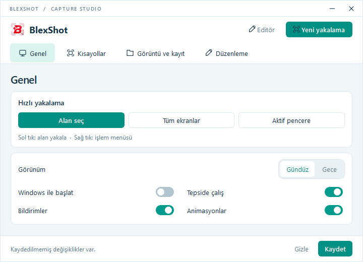

<p align="center"></p>
<h1 align="center">BlexShot</h1>
<p align="center">Yakala. Düzenle. Paylaş.</p>

Windows için kompakt ekran yakalama ve düzenleme aracı. Görüntüler cihazınızda işlenir.

[**Windows için indir**](https://github.com/kyvex372/BlexShot/releases/latest) · [Hata bildir](https://github.com/kyvex372/BlexShot/issues)



## Özellikler

- Alan, tüm ekranlar ve aktif pencere yakalama.
- Ekran üzerinde kalem, ok, şekil, metin ve numaralı işaretler.
- Blur, pikselleştirme ve opak sansür.
- Atanabilir kısayollar, açık/koyu tema ve sistem tepsisi.
- PNG/JPEG/WebP, ayarlanabilir kalite ve panoya kopyalama.

## Kullanım

`Print Screen` ile alan seçin, üzerinde düzenleyin. `Ctrl+C` ile kopyalayın, `Ctrl+S` ile kaydedin. `Esc` ile iptal edin. Tepsi simgesine sağ tıklayarak ayarlara ulaşın.

Windows 10/11 x64. Hazır EXE için Python gerekmez; uygulama dijital olarak imzalı değildir.

## Kaynaktan çalıştırma

64 bit Python 3.12+ ve Windows gerekir.

```powershell
py -3 -m venv .venv
.\.venv\Scripts\python.exe -m pip install -r requirements.txt
.\.venv\Scripts\python.exe main.py
```

**EXE üretme:** `build.bat` — çıktı: `dist/BlexShot.exe`.

**Testler:** `.\.venv\Scripts\python.exe -m unittest discover -s tests -v`

## Topluluk

[Blexa](https://discord.gg/blexa) · [FiveM Leak TR](https://discord.gg/fivemleaktr) · [GitHub](https://github.com/kyvex372)

## Lisans

Proje için henüz açık kaynak lisansı seçilmemiştir. [Üçüncü taraf bildirimleri](THIRD_PARTY_NOTICES.md).
