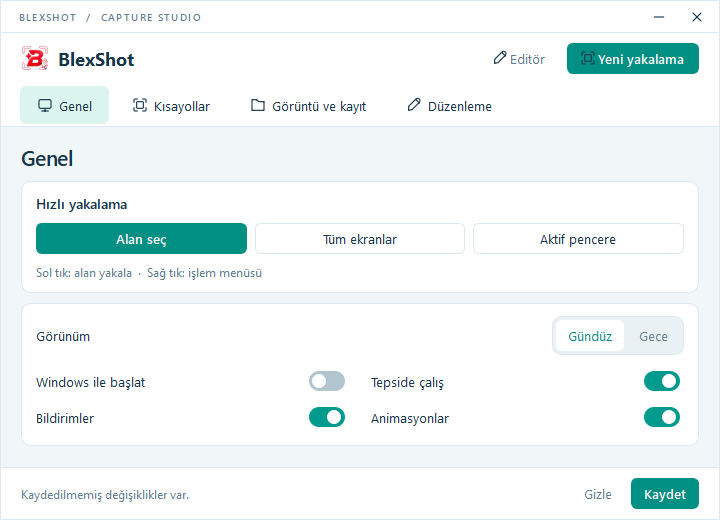
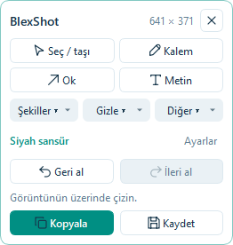

# BlexShot


**Yakala. Düzenle. Paylaş.**

Windows 10/11 için yerel ekran yakalama ve katmanlı düzenleme uygulaması. Python 3.12+, PySide6, MSS, Pillow ve OpenCV ile geliştirilmiştir. Görüntüleri bir sunucuya göndermez.

## Hızlı başlangıç

**Sürüm 1.4.1 · Windows 10/11 · 64 bit**

Alan, tüm ekran veya aktif pencereyi yakalayın. Ayrı bir editör penceresi açılmadan, görüntünün üzerinde çizim yapın; sonucu panoya kopyalayın veya PNG/JPEG/WebP olarak kaydedin. 720×520 yönetim ekranı üst sekmeler, açık/koyu görünüm, atanabilir global kısayollar ve kayıt kalitesi ayarları içerir. Araç panelindeki **Ayarlar** düğmesi renk/boyut kontrollerini açıp kapatır; metin aracı yazı alanını otomatik açar.



<details>
<summary>Ekran üstü düzenleme paneli</summary>



</details>

Hazır EXE dağıtımları GitHub **Releases** bölümünde paylaşılabilir. Kaynak deposu EXE içermez; kendiniz üretmek için aşağıdaki **EXE üretme** bölümünü kullanın.

Renk paletten veya HEX koduyla, metin ise panelin içinden canlı düzenlenir. Kopyalama ve dosya kodlama arka planda yürür; kaydetme penceresi ana olay döngüsünü durdurmadan açılır. Yakalama sırasında global kısayollar geçici olarak duraklatılır ve oturum kapanınca geri gelir.

Kısayol kutusuna tıklayın, tuşlara basıp bırakın, ardından **Kaydet** seçin. PgUp/PgDown, Home/End, Insert/Delete, yönler, harfler, rakamlar, numpad ve medya tuşları desteklenir. Windows'a ayrılmış veya başka uygulamanın kullandığı birleşimler sistem tarafından reddedilebilir.

46 otomatik test; Windows üzerinde PgUp atama, kalıcılık ve native olay testi; iki monitörde seçim, canlı çizim, kopyalama ve kaydetme akışları doğrulandı. Standart derleme `dist/BlexShot.exe` dosyasını üretir.

Hazır EXE Python kurulumu gerektirmez. Eski sürüm açıksa önce tepsi menüsünden **Çıkış** yapın. Açılışta kompakt yönetim penceresi görünür. **Tepsiye küçült** düğmesiyle arka planda bırakabilirsiniz. Bildirim alanındaki logoya **sol tıklamak doğrudan alan yakalamayı**, **sağ tıklamak hızlı işlem menüsünü** açar. Sağ menüde **Yönetim ve ayarlar**, **Editörü aç**, yakalama seçenekleri ve **Çıkış** bulunur.

1. `Print Screen` ile yakalamayı başlatın.
2. İstediğiniz alanı sürükleyerek seçin. Fareyi bıraktığınız anda alan aynı konumda düzenlemeye hazır olur; büyük uygulama penceresi açılmaz.
3. Seçimin yanında açılan yüzen araç çubuğundan kalem, ok, şekil, metin, blur, piksel veya sansür seçin. Çizerken sonucu canlı görün. `F`, ilk alan seçimi aşamasında bulunduğunuz monitörü seçer.
4. Çubuktan çizgi/yazı boyutunu, blur yoğunluğunu, opaklığı ve rengi değiştirin. Paneli başlığından sürükleyin.
5. `Ctrl+C` veya `Enter` düzenlenmiş görüntüyü panoya kopyalar ve yakalamayı kapatır. Discord, WhatsApp, Telegram gibi uygulamalarda `Ctrl+V` kullanın.
6. `Ctrl+S` doğrudan dosya kaydetme penceresini açar. Kaydedince yakalama kapanır; uygulama editörü açılmaz. Kaydetme penceresinden vazgeçerseniz ekran üzerinde düzenlemeye devam edersiniz.
7. `Esc` devam eden çizimi/seçili nesneyi bırakır; bir daha `Esc` yakalamayı iptal eder. Alanı düzeltmek için **Diğer → Seçim alanını düzelt** seçip seçim kenarlarını veya seçimin içini sürükleyin. Var olan çizimler masaüstündeki konumunu korur.

Son kopyalanan/kaydedilen görüntü, yalnızca isterseniz sağ tepsi menüsündeki **Editörü aç** ile büyük editörde görüntülenir. Dosyadan açma, ayrıntılı katman listesi ve yakınlaştırma bu isteğe bağlı editörde bulunur. Büyük editörden kaydetme öncesinde önizleme gösterilir; hızlı yakalama akışında görüntünün kendisi ekran üstündeki canlı önizlemedir.

**Global yakalama kısayolları:** `Print Screen` alan seçer, `Ctrl+Print Screen` tüm monitörleri yakalar, `Alt+Print Screen` o anda öndeki pencerenin görünür ekran bölgesini yakalar. Arayüzdeki “Aktif pencere” düğmesi pencere değiştirmeniz için 3 saniye bekler. Kısayollar Ayarlar'dan değiştirilebilir. Bir kısayol başka bir yazılım tarafından alınmışsa uygulama bunu bildirir; arayüzdeki yakalama düğmeleri çalışmaya devam eder. Windows'un Print Screen ile Ekran Alıntısı Aracı'nı açma tercihi çakışırsa Windows Ayarları → Erişilebilirlik → Klavye bölümünden bu tercihi kapatabilir veya farklı bir kısayol seçebilirsiniz.

## Düzenleme

| Araç | Tuş | Kullanım |
|---|---|---|
| Seç / taşı | V | Nesneyi sürükleyin; şekil ve gizlilik bölgelerini köşelerden boyutlandırın |
| Kalem | P | Serbest çizim |
| Ok / çizgi | A / L | Başlangıçtan bitişe sürükleyin |
| Dikdörtgen / elips | R / E | İki köşe arasında sürükleyin |
| Vurgulayıcı | H | Geniş, yarı saydam çizim |
| Metin | T | Tıklayın, çok satırlı metin girin; V ile çift tıklayıp düzenleyin |
| Numaralı işaret | N | Her tıklamada sonraki numara |
| Gaussian blur | B | Alan seçin; yoğunluk değerini değiştirin |
| Pikselleştirme | X | Alan seçin; yoğunluk blok boyutunu belirler |
| Siyah sansür | K | Alanı tamamen opak siyahla kapatır |
| Nesne silgisi | D | Üzerinden geçtiğiniz çizim katmanını kaldırır |
| Kaydırma | G | İsteğe bağlı büyük editörde görüntüyü sürükleyin |

- Çizimler ve gizlilik alanları oturum sırasında ayrı nesne katmanlarıdır. Ekran üzerinde `V` ile seçip taşıyın, gizlilik/şekil köşelerinden boyutlandırın. Ayrıntılı katman listesi, görünürlük ve sıralama isteğe bağlı büyük editörde bulunur. Dışa aktarılan dosyalar düzleştirilir; düzenlenebilir proje dosyası biçimi bu sürümde yoktur.
- Renk, çizgi kalınlığı, opaklık ve yazı boyutu yeni çizimlere veya seçili nesneye uygulanır. Blur/piksel/sansür araçları gizlenecek alanı yarı saydam bırakmamak için daima tam opaklıkla işlenir.
- `Ctrl+Z` geri alır; `Ctrl+Y` veya `Ctrl+Shift+Z` yeniden yapar. Son 80 düzenleme saklanır; geçmişte tüm ekran görüntülerinin kopyaları tutulmaz.
- `Delete` / `Backspace` seçili nesneyi siler. Ok tuşları 1 px, `Shift+Ok` 10 px taşır.
- Büyük editörde fare tekerleği yakınlaştırır; orta tuş veya `Space+sürükle` kaydırır. `Ctrl+0` sığdırır; `Ctrl+1` gerçek piksel boyutuna geçer. Ekran üstü yakalamada piksel konumu sabit tutulur.
- `Esc` devam eden çizimi/taşıma işlemini iptal eder. `Ctrl+O` görüntü açar, `Ctrl+N` yeni yakalama başlatır, `Ctrl+Q` çıkar.
- Silgi kaynak görüntüyü değiştirmez; çizim nesnesini siler. Kaynak görüntüyü gizlemek için blur, piksel veya siyah sansür kullanın.
- Ekran üstü araç panelini başlığından taşıyın. Konumu monitörün kullanılabilir alanına sıkıştırılır. **Yüzen araçlar** düğmesi çubuğu yeniden açar/kapatır.

## Ayarlar ve veriler

Kompakt yönetim penceresinin üst kısmında dört sekme bulunur:

- **Genel:** Hızlı yakalama, koyu/açık tema, başlangıç, tepsi, bildirim ve animasyon tercihleri.
- **Kısayollar:** Alan, tüm ekranlar ve aktif pencere için alanı seçip istediğiniz tuş birleşimine basın.
- **Görüntü:** Kayıt biçimi, %1–100 kalite, WebP kayıpsız modu ve kayıt klasörü.
- **Düzenleyici:** Varsayılan çizim rengi, kalem kalınlığı ve blur yoğunluğu.

Tercihleri **Kaydet** ile uygulayın. Yönetim penceresi açıkken de yakalama yapılabilir; yakalama sırasında gizlenir, seçim iptal edilirse geri açılır.

- Ayarlar: `%LOCALAPPDATA%\BlexShot\settings.json` — geçici dosya ve atomik değiştirme ile yazılır.
- Hata günlüğü: `%LOCALAPPDATA%\BlexShot\blexshot.log` — en fazla 3 × 1 MB.
- Başlangıç tercihi açılırsa yalnızca geçerli kullanıcının `HKCU\Software\Microsoft\Windows\CurrentVersion\Run\BlexShot` girdisi değiştirilir. Varsayılan olarak kapalıdır. EXE'yi taşıdıktan sonra tercihi kapatıp açın.
- Pencereyi kapatmak varsayılan olarak tepsiye küçültür. Gerçek çıkışta ve yeni görüntüye geçişte kaydedilmemiş çalışma sorulur.
- Tek uygulama örneği çalışır; ikinci kez açıldığında tepsi simgesine yönlendiren bilgi gösterilir.
- PNG daima kayıpsızdır. JPEG ve kayıplı WebP için kalite %1–100 aralığında ayarlanabilir; düşük değer daha küçük dosya üretir. JPEG'de chroma subsampling kapalıdır. WebP varsayılan olarak kayıpsızdır; kalite kaydırıcısını kullanmak için kayıpsız tercihini kapatın. Tercih kaydedilen dosyaya uygulanır; pano görüntüsünün kalitesi ve piksel boyutları korunur.

## Kaynaktan çalıştırma

Windows üzerinde Python **3.12 veya üstü, 64 bit** gerekir. Bu çalışma ortamında Python 3.14.6 ile test edilmiştir.

```powershell
py -3 -m venv .venv
.\.venv\Scripts\python.exe -m pip install -r requirements.txt
.\.venv\Scripts\python.exe tools\make_icon.py
.\.venv\Scripts\python.exe main.py
```

Kurulumdan sonra `run.bat` konsol penceresiz çalıştırır. `main.py --tray` tepside başlatır.

## EXE üretme

**`build.bat`** bağımlılıkları kurar, uygulama ikonlarını üretir, testleri çalıştırır ve PyInstaller paketini oluşturur:

```text
dist/BlexShot.exe
```

Tek dosyalı `--windowed` karşılığı paket kullanılır; konsol açılmaz. İkonlar ve DPI manifesti paketlenir. Paket açılışta Qt/OpenCV kitaplıklarını geçici klasöre açtığı için ilk başlatma kaynak sürümünden daha uzun sürebilir. Yönetici ayrıcalığı gerekmez. Paket dijital olarak imzalı değildir.

Spec, derleme işleminin DLL arama yolunu Python ve Windows sistem klasörleriyle sınırlar. Böylece bilgisayardaki başka araçların ICU/UCRT kitaplıkları yanlışlıkla pakete girmez; kullanıcının kalıcı PATH ayarı değiştirilmez.

Derleme sonunda `tools/verify_package.py`, Python klasörleri PATH'te bulunmadan EXE'yi kısa bir açılış testinden geçirir ve 64 bit/konsolsuz paket başlıklarını doğrular. Test geçici bir veri klasörü kullanır; mevcut kullanıcı ayarlarını değiştirmez.

Yalnızca yeniden paketlemek için:

```powershell
.\.venv\Scripts\python.exe -m PyInstaller --noconfirm BlexShot.spec
```

`requirements-lock.txt`, teslim paketinde kullanılan tam sürümleri kaydeder. Aynı bağımlılıklarla yeniden üretmek için bu dosyayı `pip install -r` ile kullanın. Üçüncü taraf bileşenlerin lisansları için `THIRD_PARTY_NOTICES.md` dosyasına bakın.

## Yapı

```text
main.py                    Başlatıcı ve DPI farkındalığı
snapforge/app.py           Uygulama yaşam döngüsü, tepsi, yakalama akışı
snapforge/platform.py      Tipli Win32 sınırı, başlangıç tercihi, kaynak yolları
snapforge/hotkeys.py       RegisterHotKey ve Qt native event filtresi
snapforge/capture.py       MSS, monitör katmanları, fiziksel piksel seçimi
snapforge/inline.py        Uygulama penceresi açmadan ekran üzerinde canlı düzenleme
snapforge/palette.py       Etiketli araçlar ve canlı özellik paneli
snapforge/exporting.py     Arka planda render ve dışa aktarma
snapforge/management.py    Yönetim ekranı
snapforge/controls.py      Özel kontroller ve kısayol kaydedici
snapforge/document.py      Katman verileri ve undo/redo
snapforge/canvas.py        Canlı çizim, seçim, taşıma, zoom/pan
snapforge/imaging.py       OpenCV efektleri, Qt çizimi, Pillow dışa aktarma
snapforge/rendering.py     Birleştirilen arka plan önizleme kuyruğu
snapforge/window.py        Ana pencere ve editör
snapforge/dialogs.py       Ayarlar ve dışa aktarma önizlemesi
snapforge/settings.py      Kalıcı, doğrulanan JSON ayarları
snapforge/theme.py         Koyu/açık tema
snapforge/icons.py         Vektör araç ikonları
snapforge/widgets.py       Animasyonlu araç düğmeleri, yüzen çubuk
resources/                 Uygulama ikonu ve PerMonitorV2 manifesti
tests/                     Çizim, piksel, tarihçe, kayıt ve arayüz testleri
tools/                     İkon üretimi, Windows entegrasyon ve UI kontrolü
```

## Doğrulama ve sınırlar

```powershell
.\.venv\Scripts\python.exe -m unittest discover -s tests -v
.\.venv\Scripts\python.exe tools\verify_windows.py
```

İkinci komut Windows masaüstünde kendi test penceresini gösterir, geçici global kısayollar kaydeder, panoya test görüntüsü yazar ve `artifacts/` altında sonuç üretir. Ayarları veya Windows başlangıç tercihini değiştirmez.

Teslim sırasında Windows 11 üzerinde 1920×1080 ve negatif X/Y konumlu dikey 768×1366 monitörle gerçek MSS yakalama, seçim, düzenleme, pano, PNG kaydı, kısayol çakışması ve native olay teslimi doğrulandı. 4K görüntüde 2600×1500 bölgeye sigma 18 blur bu makinede yaklaşık 133 ms sürdü; bu değer diğer makineler için bir performans garantisi değildir.

- Farklı ölçekli monitörler için ekran başına DIP → fiziksel piksel dönüşümü kullanılır; %125/%150 gibi **karma DPI donanım düzenleri bu ortamda fiziksel olarak test edilmedi**. Negatif koordinatlar otomatik testlerle de kapsanır.
- Aktif pencere yakalama, pencerenin masaüstünde görünen kısmını alır. Örtülmüş, küçültülmüş, DRM korumalı içerik ve Windows güvenli masaüstü yakalanmaz.
- Blur/piksel önizlemesi arka planda üretilir. Kaydetme/pano son katman durumunu yeniden işler; bekleyen önizlemeyi yanlışlıkla dışa aktarmaz.
- Görüntüler kaydedilene/kopyalanana kadar bellekte bulunur; çökmeye karşı otomatik oturum kurtarma yoktur.
- 960×680 mantıksal piksel ve üzeri editör penceresi hedeflenir. Dar/yüksek DPI ekranlarında panel ve araç listesi kaydırılabilir.

Teknik referanslar: [Qt native event filtresi](https://doc.qt.io/qtforpython-6/PySide6/QtCore/QAbstractNativeEventFilter.html), [MSS kullanımı](https://python-mss.readthedocs.io/latest/usage.html), [Microsoft Per-Monitor DPI](https://learn.microsoft.com/en-us/windows/win32/hidpi/high-dpi-desktop-application-development-on-windows).

## GitHub ve katkı

GitHub'a yükleme, kaynak ZIP'i ve EXE dağıtım adımları: [GitHub yükleme rehberi](GITHUB.md).
Geliştirme ve hata bildirme: [CONTRIBUTING.md](../CONTRIBUTING.md).

Windows testleri push ve pull request üzerinde çalışır. `v*` etiketlerinde veya Actions sayfasından elle istendiğinde EXE oluşturulup workflow artifact'i olarak saklanır. Workflow otomatik Release yayımlamaz.

## Lisans

Bu proje için henüz bir açık kaynak lisansı seçilmemiştir. Üçüncü taraf bileşenlerin lisansları kendilerine aittir; [THIRD_PARTY_NOTICES.md](../THIRD_PARTY_NOTICES.md) dosyasına bakın.
